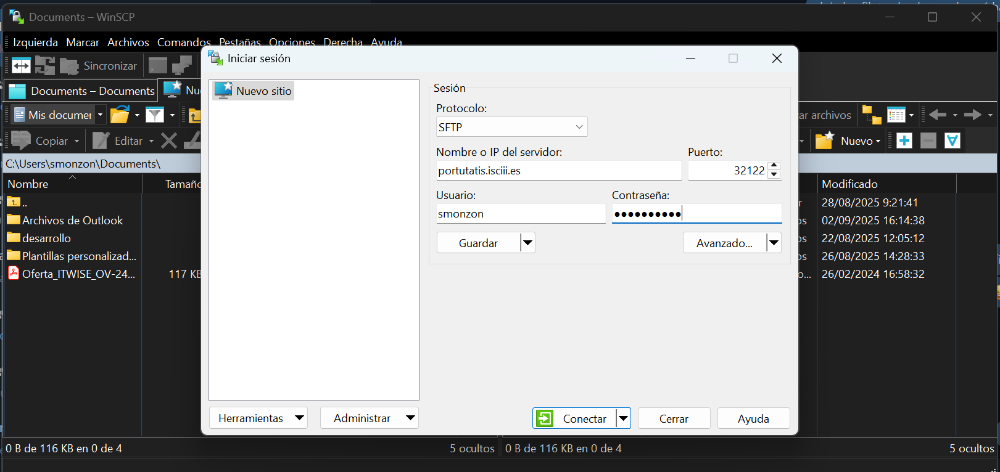
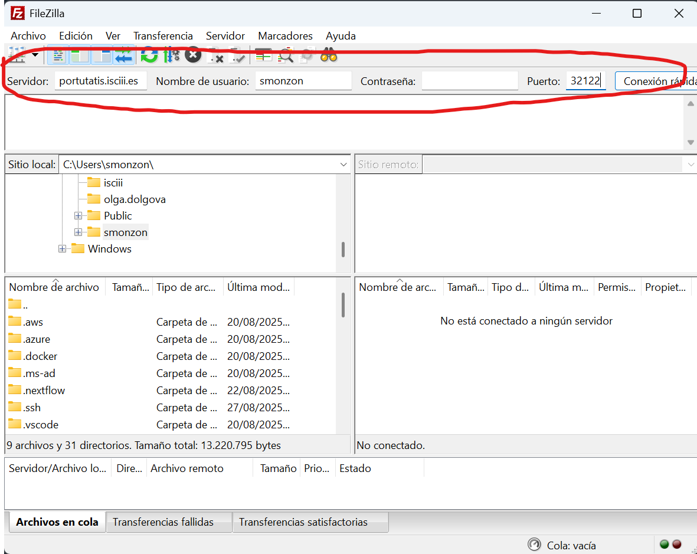

# Curso Práctico de Iniciación al uso del Entorno de Alta Computación

BU-ISCIII

## Práctica 4: Acceso y transferencia de datos al clúster

## Índice

- [Curso Práctico de Iniciación al uso del Entorno de Alta Computación](#curso-práctico-de-iniciación-al-uso-del-entorno-de-alta-computación)
  - [Práctica 4: Acceso y transferencia de datos al clúster](#práctica-4-acceso-y-transferencia-de-datos-al-clúster)
  - [Índice](#índice)
    - [Descripción](#descripción)
    - [Notas importantes](#notas-importantes)
    - [Ejercicio 1: Conexión SSH](#ejercicio-1-conexión-ssh)
      - [Opciones de depuración](#opciones-de-depuración)
    - [Ejercicio 2: Exploración del entorno](#ejercicio-2-exploración-del-entorno)
    - [Ejercicio 3: Configuración de clave SSH](#ejercicio-3-configuración-de-clave-ssh)
    - [Ejercicio 4: Transferencia de datos](#ejercicio-4-transferencia-de-datos)
      - [Subir archivo con `scp`](#subir-archivo-con-scp)
      - [Descargar archivo con `scp`](#descargar-archivo-con-scp)
      - [Sincronizar carpeta con `rsync`](#sincronizar-carpeta-con-rsync)
      - [Sincronizar carpeta con WinScp](#sincronizar-carpeta-con-winscp)
      - [Sincronizar carpeta con Filezilla](#sincronizar-carpeta-con-filezilla)
    - [Ejercicio 5: Verificación de integridad](#ejercicio-5-verificación-de-integridad)
    - [Ejercicio 6: Organización de proyecto](#ejercicio-6-organización-de-proyecto)

### Descripción

En esta práctica aprenderás a:

- Conectarte al clúster HPC usando SSH.
- Explorar el entorno de trabajo.
- Configurar intercambio de claves SSH para no tener que introducir la contraseña en cada conexión.
- Transferir datos entre tu equipo y el clúster utilizando diferentes herramientas (línea de comandos y programas con interfaz gráfica).
- Verificar la integridad de los ficheros transferidos mediante checksums.
- Construir una estructura de directorios para organizar un proyecto.

### Notas importantes

- El acceso se realiza al nodo de login `portutatis.isciii.es` mediante el puerto `32122`.
- No se deben ejecutar cálculos en el nodo de login, solo gestionar ficheros y enviar trabajos a la cola.
- Los datos de usuario se organizan en diferentes espacios de trabajo:

  - `/home/usuario` → scripts y ficheros pequeños.
  - `/data/unidad` → datos y resultados de proyectos.
  - `/scratch/unidad` → ejecución temporal de trabajos (se eliminan ficheros inactivos a los 5 días).
  - `/local_scratch` → espacio temporal en cada nodo, se elimina al terminar el trabajo.
- No almacenar información no relacionada con los cálculos autorizados.

### Ejercicio 1: Conexión SSH

- Lo primero que vamos a hacer es conectarnos al clúster con nuestras credenciales personales.

```bash
ssh -p 32122 usuario@portutatis.isciii.es
exit
```

Output:

```bash
usuario@portutatis.isciii.es's password:
Last login: Tue Aug 20 10:21:45 2025 from 192.168.1.10
[usuario@portutatis ~]$
```

El sistema solicita la contraseña del usuario. Tras introducirla, accedemos al nodo de login, donde aparece el `prompt` con nuestro nombre de usuario y la ruta `~` que corresponde al directorio `/home/usuario`.

#### Opciones de depuración

Si la conexión falla, podemos añadir opciones de depuración:

- **Modo detallado (-v):**

```bash
exit
ssh -v -p 32122 usuario@portutatis.isciii.es
exit
```

Muestra información sobre cada paso de la conexión SSH. Útil para identificar problemas de autenticación.

Output:

```bash
 ✘  smonzon@PC-M007021  ssh -v -p 32122 smonzon@portutatis.isciii.es
OpenSSH_9.6p1 Ubuntu-3ubuntu13.13, OpenSSL 3.0.13 30 Jan 2024
debug1: Reading configuration data /home/smonzon/.ssh/config
debug1: /home/smonzon/.ssh/config line 16: Applying options for portutatis.isciii.es
debug1: Reading configuration data /etc/ssh/ssh_config
debug1: /etc/ssh/ssh_config line 19: include /etc/ssh/ssh_config.d/*.conf matched no files
debug1: /etc/ssh/ssh_config line 21: Applying options for *
debug1: Connecting to portutatis.isciii.es [172.21.7.100] port 32122.
debug1: Connection established.
debug1: identity file /home/smonzon/.ssh/id_rsa type -1
debug1: identity file /home/smonzon/.ssh/id_rsa-cert type -1
debug1: identity file /home/smonzon/.ssh/id_ecdsa type -1
debug1: identity file /home/smonzon/.ssh/id_ecdsa-cert type -1
debug1: identity file /home/smonzon/.ssh/id_ecdsa_sk type -1
debug1: identity file /home/smonzon/.ssh/id_ecdsa_sk-cert type -1
debug1: identity file /home/smonzon/.ssh/id_ed25519 type 3
debug1: identity file /home/smonzon/.ssh/id_ed25519-cert type -1
debug1: identity file /home/smonzon/.ssh/id_ed25519_sk type -1
debug1: identity file /home/smonzon/.ssh/id_ed25519_sk-cert type -1
debug1: identity file /home/smonzon/.ssh/id_xmss type -1
debug1: identity file /home/smonzon/.ssh/id_xmss-cert type -1
debug1: identity file /home/smonzon/.ssh/id_dsa type -1
debug1: identity file /home/smonzon/.ssh/id_dsa-cert type -1
debug1: Local version string SSH-2.0-OpenSSH_9.6p1 Ubuntu-3ubuntu13.13
debug1: Remote protocol version 2.0, remote software version OpenSSH_8.0
debug1: compat_banner: match: OpenSSH_8.0 pat OpenSSH* compat 0x04000000
debug1: Authenticating to portutatis.isciii.es:32122 as 'smonzon'
debug1: load_hostkeys: fopen /home/smonzon/.ssh/known_hosts2: No such file or directory
debug1: load_hostkeys: fopen /etc/ssh/ssh_known_hosts: No such file or directory
debug1: load_hostkeys: fopen /etc/ssh/ssh_known_hosts2: No such file or directory
debug1: SSH2_MSG_KEXINIT sent
debug1: SSH2_MSG_KEXINIT received
debug1: kex: algorithm: curve25519-sha256
debug1: kex: host key algorithm: ssh-ed25519
debug1: kex: server->client cipher: chacha20-poly1305@openssh.com MAC: <implicit> compression: none
debug1: kex: client->server cipher: chacha20-poly1305@openssh.com MAC: <implicit> compression: none
debug1: expecting SSH2_MSG_KEX_ECDH_REPLY
debug1: SSH2_MSG_KEX_ECDH_REPLY received
debug1: Server host key: ssh-ed25519 SHA256:J+mEtn68NKuPOhGTtFiJBdEgnALrlYJH4B5q40P3vBY
debug1: load_hostkeys: fopen /home/smonzon/.ssh/known_hosts2: No such file or directory
debug1: load_hostkeys: fopen /etc/ssh/ssh_known_hosts: No such file or directory
debug1: load_hostkeys: fopen /etc/ssh/ssh_known_hosts2: No such file or directory
debug1: Host '[portutatis.isciii.es]:32122' is known and matches the ED25519 host key.
debug1: Found key in /home/smonzon/.ssh/known_hosts:56
debug1: ssh_packet_send2_wrapped: resetting send seqnr 3
debug1: rekey out after 134217728 blocks
debug1: SSH2_MSG_NEWKEYS sent
debug1: expecting SSH2_MSG_NEWKEYS
debug1: ssh_packet_read_poll2: resetting read seqnr 3
debug1: SSH2_MSG_NEWKEYS received
debug1: rekey in after 134217728 blocks
debug1: SSH2_MSG_EXT_INFO received
debug1: kex_ext_info_client_parse: server-sig-algs=<ssh-ed25519,ssh-rsa,rsa-sha2-256,rsa-sha2-512,ssh-dss,ecdsa-sha2-nistp256,ecdsa-sha2-nistp384,ecdsa-sha2-nistp521>
debug1: SSH2_MSG_SERVICE_ACCEPT received
debug1: Authentications that can continue: publickey,gssapi-keyex,gssapi-with-mic,password
debug1: Next authentication method: gssapi-with-mic
debug1: No credentials were supplied, or the credentials were unavailable or inaccessible
No Kerberos credentials available (default cache: FILE:/tmp/krb5cc_1212)
debug1: No credentials were supplied, or the credentials were unavailable or inaccessible
No Kerberos credentials available (default cache: FILE:/tmp/krb5cc_1212)
debug1: Next authentication method: publickey
debug1: Will attempt key: /home/smonzon/.ssh/id_rsa
debug1: Will attempt key: /home/smonzon/.ssh/id_ecdsa
debug1: Will attempt key: /home/smonzon/.ssh/id_ecdsa_sk
debug1: Will attempt key: /home/smonzon/.ssh/id_ed25519 ED25519 SHA256:mwmdFtDTXOXTChh+RKun1e9igQ3jt6ldU7Gd/XaALpk
debug1: Will attempt key: /home/smonzon/.ssh/id_ed25519_sk
debug1: Will attempt key: /home/smonzon/.ssh/id_xmss
debug1: Will attempt key: /home/smonzon/.ssh/id_dsa
debug1: Trying private key: /home/smonzon/.ssh/id_rsa
debug1: Trying private key: /home/smonzon/.ssh/id_ecdsa
debug1: Trying private key: /home/smonzon/.ssh/id_ecdsa_sk
debug1: Offering public key: /home/smonzon/.ssh/id_ed25519 ED25519 SHA256:mwmdFtDTXOXTChh+RKun1e9igQ3jt6ldU7Gd/XaALpk
debug1: Authentications that can continue: publickey,gssapi-keyex,gssapi-with-mic,password
debug1: Trying private key: /home/smonzon/.ssh/id_ed25519_sk
debug1: Trying private key: /home/smonzon/.ssh/id_xmss
debug1: Trying private key: /home/smonzon/.ssh/id_dsa
debug1: Next authentication method: password
smonzon@portutatis.isciii.es's password:
debug1: Authentications that can continue: publickey,gssapi-keyex,gssapi-with-mic,password
Permission denied, please try again.
smonzon@portutatis.isciii.es's password:
Authenticated to portutatis.isciii.es ([172.21.7.100]:32122) using "password".
debug1: channel 0: new session [client-session] (inactive timeout: 0)
debug1: Requesting no-more-sessions@openssh.com
debug1: Entering interactive session.
debug1: pledge: filesystem
debug1: client_input_global_request: rtype hostkeys-00@openssh.com want_reply 0
debug1: client_input_hostkeys: searching /home/smonzon/.ssh/known_hosts for [portutatis.isciii.es]:32122 / (none)
debug1: client_input_hostkeys: searching /home/smonzon/.ssh/known_hosts2 for [portutatis.isciii.es]:32122 / (none)
debug1: client_input_hostkeys: hostkeys file /home/smonzon/.ssh/known_hosts2 does not exist
debug1: client_input_hostkeys: host key found matching a different name/address, skipping UserKnownHostsFile update
debug1: pledge: fork
Last failed login: Tue Sep  2 16:28:14 CEST 2025 from 10.22.140.230 on ssh:notty
There was 1 failed login attempt since the last successful login.
Last login: Tue Sep  2 16:27:50 2025 from 10.22.140.230
```

- **Modo muy detallado (-vv o -vvv):**

```bash
ssh -vvv -p 32122 usuario@portutatis.isciii.es
exit
```

Muestra aún más detalles, incluyendo el intercambio de claves. Útil cuando el problema es con la clave pública o el fingerprint.

- **Probar conexión sin especificar puerto:**

```bash
ssh -v usuario@portutatis.isciii.es
exit
```

Output:

```bash
OpenSSH_9.6p1 Ubuntu-3ubuntu13.13, OpenSSL 3.0.13 30 Jan 2024
debug1: Reading configuration data /home/smonzon/.ssh/config
debug1: Reading configuration data /etc/ssh/ssh_config
debug1: /etc/ssh/ssh_config line 19: include /etc/ssh/ssh_config.d/*.conf matched no files
debug1: /etc/ssh/ssh_config line 21: Applying options for *
debug1: Connecting to portutatis.isciii.es [172.21.7.100] port 22.
debug1: connect to address 172.21.7.100 port 22: Connection refused
ssh: connect to host portutatis.isciii.es port 22: Connection refused
```

### Ejercicio 2: Exploración del entorno

- Ahora vamos a familiarizarnos con el nodo de acceso y los recursos disponibles del clúster. Nos conectamos al clúster con ssh de nuevo.

```bash
ssh -p 32122 usuario@portutatis.isciii.es
```

- Quienes somos y a qué grupos pertenecemos:

```bash
whoami
id
groups
```

Output:

```bash
[smonzon@portutatis03 ~]$ whoami
smonzon
[smonzon@portutatis03 ~]$ id
uid=1212(smonzon) gid=1212(smonzon) groups=1212(smonzon),900(fastqdata),1201(bi),1202(buisciii),2201(bi-ratb),2401(bi-bvih),2501(bi-mb),2601(bi-ips),2823(ucct),2827(bi-hel),3824(bi-bc),4010(bi-ib),5012(bi-lec),5013(it),5017(projects),5019(relecov),5020(genvigies)
[smonzon@portutatis03 ~]$ groups
smonzon fastqdata bi buisciii bi-ratb bi-bvih bi-mb bi-ips ucct bi-hel bi-bc bi-ib bi-lec it projects relecov genvigies
```

- Carpetas disponibles en `/`

```bash
pwd
ls -l /
```

Output:

```bash
/home/usuario

drwxr-xr-x  10 root   root   4096 Jul 10 10:00 bin
...
drwxr-xr-x   5 root root 4096 Jul 20 12:34 data
...
drwxr-xr-x   5 root root 4096 Jul 20 12:34 scratch
```

El comando `pwd` muestra la ruta actual. El comando `ls -l /` permite visualizar qué directorios principales existen: `/home`, `/data`, `/scratch`, etc. Estos son los sistemas de ficheros disponibles en el clúster.

- Podemos usar el comando `df` para ver el espacio disponible en cada uno de ellos y los puntos de montaje:

```bash
df -h
```

Output:

```bash
Filesystem                          Size  Used Avail Use% Mounted on
tmpfs                                16G  4.4G   12G  29% /
devtmpfs                             16G     0   16G   0% /dev
tmpfs                                16G  571M   15G   4% /dev/shm
tmpfs                                16G  858M   15G   6% /run
tmpfs                                16G     0   16G   0% /sys/fs/cgroup
172.21.17.100:/HPC_UI_ACTIVE         60T   54T  6.4T  90% /data
172.21.31.9:/HPC_Home               200G  151G   50G  76% /home
172.21.31.8:/HPC_UCCT_BI_ACTIVE      30T   19T   12T  61% /data/courses/hpc_course
172.21.31.9:/HPC_Scratch            7.4T  5.4T  2.0T  74% /data/courses/hpc_course/scratch_tmp
172.21.31.9:/HPC_Scratch            7.4T  5.4T  2.0T  74% /scratch
//172.21.30.97/hpc-bioinfo/         1.0T  917G  108G  90% /data/courses/hpc_course/sftp
172.21.31.9:/HPC_Soft               350G  295G   56G  85% /soft
172.21.31.8:/HPC_UCCT_ME_ARCHIVED    42T   38T  4.2T  91% /archived/ucct/me
172.21.31.8:/HPC_UCCT_BI_ARCHIVED    50T   37T   14T  74% /archived/ucct/bi
172.21.31.9:/HPC_Opt                100G   15G   86G  15% /opt
172.21.31.9:/NGS_Data_FastQ_Active   15T  8.3T  6.8T  56% /srv/fastq_repo
//172.21.30.97/hpc-genvigies/       1.0T  429G  596G  42% /sftp/genvigies
```

- Veamos por ejemplo si tenemos acceso a visualizar fastq_repo, según los permisos de los que disponemos:

```bash
ll /srv/
```

Output:

```bash
[smonzon@portutatis03 ~]$ ll /srv/
total 40
drwxrwx--- 191 root fastqdata 36864 Sep  2 17:12 fastq_repo
```

> ¿Quién tiene permisos? ¿Pertenecemos a alguno de las grupos?

- Podemos ver lo mismo con el contenido de fastq_repo:

```bash
ll /srv/fastq_repo
```

Output:

```bash
[smonzon@portutatis03 ~]$ ll /srv/fastq_repo/
total 3360
dr-xr-x--- 2 root    bi      16384 Dec 17  2024 20241213_NextSeq_GEN_495_RAbad
dr-xr-x--- 2 root    bi       4096 Dec 17  2024 20241213_NextSeq_GEN_495_SValdezate
dr-xr-x--- 2 root    bi      40960 Jan  3  2025 20241227_NextSeq_GEN_496_PPozo
dr-xr-x--- 2 root    bi      12288 May 22 12:11 MiSeq_GEN_195_20210113_ICasas
dr-xr-x--- 2 root    bi      12288 May 22 12:12 MiSeq_GEN_196_20210122_ICasas
dr-xr-x--- 2 root    bi      12288 May 22 12:14 MiSeq_GEN_197_20210129_ICasas
dr-xr-x--- 2 root    bi      12288 May 22 12:15 MiSeq_GEN_198_20210204_ICasas
dr-xr-x--- 2 root    bi      16384 May 22 12:16 MiSeq_GEN_201_20210224_ICasas
dr-xr-x--- 2 root    bi      16384 May 22 12:17 MiSeq_GEN_203_20210315_ICasas
```

- ¿Tenéis acceso a alguna de las carpetas? ¿Pertenecemos a alguno de los grupos?. Solo deberíais tener acceso si habéis secuenciado algo en vuestro grupo este último año.

- Por último en esta sección vamos a inspeccionar nuestro `.bashrc`:

```bash
cat ~/.bashrc
```

Output ejemplo (vuestro bashrc estará menos configurado):

```bash
# Source global definitions
if [ -f /etc/bashrc ]; then
        . /etc/bashrc
fi

alias si="sinfo -o \"%20P %5D %14F %8z %10m %10d %11l %16f %N\""
alias sq="squeue -o \"%8i %12j %4t %10u %20q %20a %10g %20P %10Q %5D %11l %11L %50R %10C %c\""
alias sa="squeue -u smonzon"
alias scratch="srun --partition short_idx --nodelist ideafix02 --pty bash; cd /scratch"

export NXF_SINGULARITY_CACHEDIR=/data/courses/hpc_course/pipelines/singularity-images
export LC_ALL="en_US.UTF-8"
export R_LIBS_USER=/data/courses/hpc_course/pipelines/r-lib/
```

El archivo .bashrc es un script de configuración que se ejecuta automáticamente cada vez que abrimos una nueva shell interactiva de Bash.

Sirve para personalizar el entorno del usuario: definir variables de entorno, cargar módulos, configurar el prompt, crear alias y funciones, etc.

### Ejercicio 3: Configuración de clave SSH

- Ahora vamos a configurar nuestra key ssh para poder conectarnos sin necesidad de escribir contraseña en cada acceso.
- Debemos generar la clave ssh-key desde nuestro ordenador local y copiarla a portutatis.isciii.es. Por lo tanto *salimos del HPC con `exit`*

```bash
ssh-keygen -t ed25519 -f ~/.ssh/id_ed25519
ssh-copy-id -i ~/.ssh/id_ed25519 -p 32122 usuario@portutatis.isciii.es
```

Output:

```bash
Generating public/private rsa key pair.
Enter file in which to save the key (/home/local/.ssh/id_rsa):
Enter passphrase (empty for no passphrase):
...
Number of keys added: 1
Now try logging into the machine, with:   ssh 'usuario@portutatis.isciii.es'
```

El comando `ssh-keygen` genera una nueva clave pública/privada en el directorio `~/.ssh/`. Con `ssh-copy-id` copiamos la clave al clúster. A partir de este momento, las conexiones SSH se autentican sin pedir la contraseña.

### Ejercicio 4: Transferencia de datos

- En este ejercicio vamos a tranferir archivos desde nuestro ordenador local al hpc con varias opciones: `scp`, `rsync`, WinSCP o FileZilla.

#### Subir archivo con `scp`

- Descargamos los datos de la práctica en nuestro ordenador local. Bien en [zenodo](https://zenodo.org/records/17207071) o por línea de comandos:

```bash
wget --content-disposition -P hpc_isciii_data https://zenodo.org/api/records/17207071/files-archive
cd hpc_isciii_data
```

- Nos movemos a donde hemos descargado los datos:

```bash
cd /path/to/where/hpc_isciii_data_is
scp -r -P 32122 hpc_isciii_data usuario@portutatis.isciii.es:/home/hpc_course/usuario
```

Output:

```bash
ERR2261315_2.fastq.gz                                                                                                                                                            100%   99MB  54.9MB/s   00:01
ERR2261314_2.fastq.gz                                                                                                                                                            100%   95MB  52.9MB/s   00:01
ERR2261314_1.fastq.gz                                                                                                                                                            100%   76MB  54.0MB/s   00:01
ERR2261318_2.fastq.gz                                                                                                                                                            100%  140MB  53.3MB/s   00:02
ERR2261315_1.fastq.gz                                                                                                                                                            100%   81MB  53.8MB/s   00:01
ERR2261318_1.fastq.gz                                                                                                                                                            100%  116MB  53.1MB/s   00:02
virus1_R2.fastq.gz                                                                                                                                                               100%   13MB  46.9MB/s   00:00
virus1_R1.fastq.gz                                                                                                                                                               100%   13MB  62.2MB/s   00:00
```

#### Descargar archivo con `scp`

```bash
scp -P 32122 usuario@portutatis.isciii.es:/home/hpc_course/usuario/hpc_isciii_data/ERR2261314_1.fastq.gz ./
```

Output:

```bash
ERR2261314_1.fastq.gz
                                                                                                 100%   76MB  89.5MB/s   00:00
```

#### Sincronizar carpeta con `rsync`

```bash
rsync -avz -e "ssh -p 32122" hpc_isciii_data usuario@portutatis.isciii.es:/home/hpc_course/usuario
```

Output:

```bash
sending incremental file list
data/
data/ERR2261314_1.fastq.gz
data/ERR2261314_2.fastq.gz
data/ERR2261315_1.fastq.gz
data/ERR2261315_2.fastq.gz
data/ERR2261318_1.fastq.gz
data/ERR2261318_2.fastq.gz
data/virus1_R1.fastq.gz
data/virus1_R2.fastq.gz

sent 664,244,980 bytes  received 172 bytes  35,905,143.35 bytes/sec
total size is 663,867,202  speedup is 1.00
```

#### Sincronizar carpeta con WinScp

- Abrimos WinSCP y configuramos un nuevo sitio



- Damos a conectar
- Una vez conectado arrastra los ficheros del panel de la izquierda al panel de la derecha.

#### Sincronizar carpeta con Filezilla

- Abrimos Filezilla y conectamos usando las credenciales:



- Una vez conectado igual que winscp arrastramos del panel de la izquierda (nuestro ordenador local), al panel de la derecha (el servidor remoto).

Resumen:

- `scp` copia archivos individuales de manera directa.
- `rsync` sincroniza directorios y solo transfiere cambios, lo que ahorra tiempo en transferencias repetidas.
- --WinSCP-- y --FileZilla-- ofrecen interfaz gráfica, con arrastrar y soltar. La configuración requiere: `host = portutatis.isciii.es`, `puerto = 32122`, `usuario = usuario`.

### Ejercicio 5: Verificación de integridad

- Ahora vamos a comprobar que los archivos no se corrompen al transferirse.

```bash
# En nuestro ordenador local creamos el fichero md5sum de los ficheros
cd /path/to/hpc_isciii_data
md5sum *.gz > md5sum.md5
scp -P 32122 md5sum.md5 usuario@portutatis.isciii.es:/home/hpc_course/usuario/hpc_isciii_data
ssh -p 32122 usuario@portutatis.isciii.es "cd /home/hpc_course/usuario/hpc_isciii_data;md5sum -c md5sum.md5"
```

Output:

```bash
ERR2261314_1.fastq.gz: OK
ERR2261314_2.fastq.gz: OK
ERR2261315_1.fastq.gz: OK
ERR2261315_2.fastq.gz: OK
ERR2261318_1.fastq.gz: OK
ERR2261318_2.fastq.gz: OK
virus1_R1.fastq.gz: OK
virus1_R2.fastq.gz: OK
```

Output si fallase alguno:

```bash
ERR2261314_1.fastq.gz: OK
ERR2261314_2.fastq.gz: OK
ERR2261315_1.fastq.gz: OK
ERR2261315_2.fastq.gz: OK
ERR2261318_1.fastq.gz: OK
ERR2261318_2.fastq.gz: OK
virus1_R1.fastq.gz: OK
virus1_R2.fastq.gz: FAILED
md5sum: WARNING: 1 computed checksum did NOT match
```

Explicación:
Un checksum es un valor hash generado a partir del contenido de un archivo. Si el archivo se modifica durante la transferencia, el valor no coincide y se detecta el error.

### Ejercicio 6: Organización de proyecto

- Por ultimo vamos a crear una estructura de directorios estándar para organizar datos.

```bash
# recordad conectarse al hpc primero
ssh -p 32122 usuario@portutatis.isciii.es
mkdir -p /data/courses/hpc_course/$(date +%Y%m%d)_HPC-COURSE_${USER}/{RAW,ANALYSIS,RESULTS,DOC,TMP,REFERENCES}
ls -R /data/courses/hpc_course/$(date +%Y%m%d)_HPC-COURSE_${USER}
```

Output:

```bash
/data/courses/hpc_course/20250902_HPC-COURSE_smonzon:
ANALYSIS  DOC  RAW  REFERENCES  RESULTS  TMP
/data/courses/hpc_course/20250902_HPC-COURSE_smonzon/ANALYSIS:
/data/courses/hpc_course/20250902_HPC-COURSE_smonzon/DOC:
/data/courses/hpc_course/20250902_HPC-COURSE_smonzon/RAW:
/data/courses/hpc_course/20250902_HPC-COURSE_smonzon/REFERENCES:
/data/courses/hpc_course/20250902_HPC-COURSE_smonzon/RESULTS:
/data/courses/hpc_course/20250902_HPC-COURSE_smonzon/TMP:
```

- Ahora ya podemos copiar los ficheros que hemos subido al HPC a la estructura de carpetas que hemos creado. Como son ficheros crudos de secuenciación los copiaremos en `RAW`.

```bash
cd /home/hpc_course/usuario
rsync -rlv hpc_isciii_data/* /data/courses/hpc_course/$(date +%Y%m%d)_HPC-COURSE_${USER}/RAW
```

La organización clara de los proyectos permite localizar fácilmente los datos, compartir con colaboradores y evitar problemas de almacenamiento. Ya tenemos nuestros datos preparados para el resto de las prácticas.
